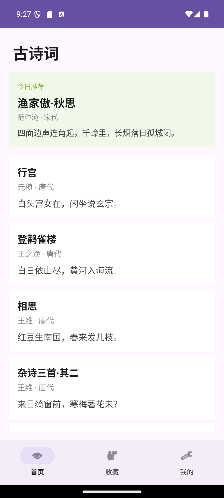
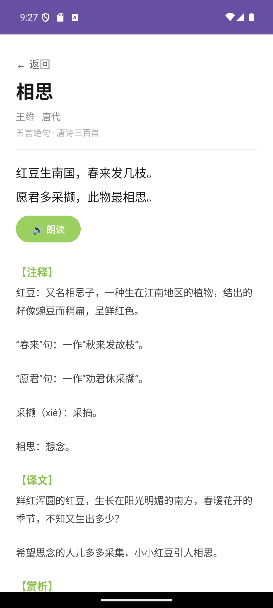
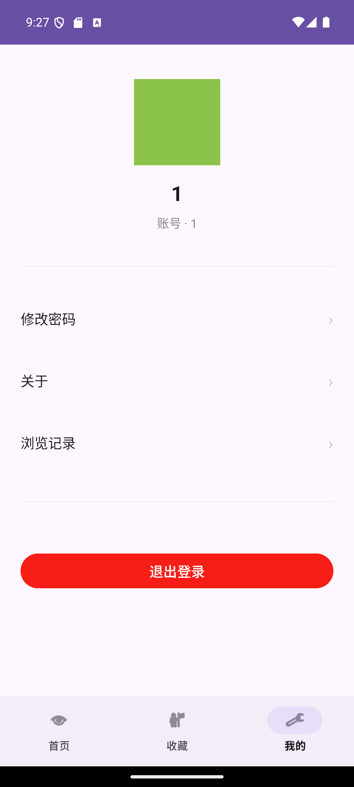
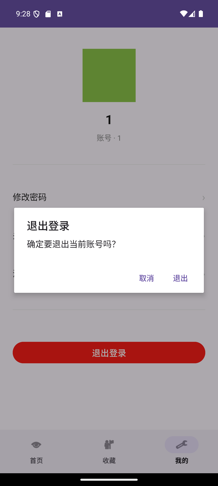

# PoemApp — 古诗词学习 App

一个面向古诗词爱好者的 Android 学习工具，支持浏览、朗读与收藏。
2026 年第二十一届「我的互联网+」绘蓝杯科技竞赛 B 组（APP 开发）参赛作品。

---

## 功能

### 已完成

- **账号体系**
  - 独立登录页、注册页
  - 多用户支持（SQLite `users` 表，可注册任意多个账号）
  - 记住密码（复选可选）
  - 已登录自动跳过登录页
  - 退出登录（二次确认弹窗）
- **主界面**
  - 底部导航栏（首页 / 收藏 / 我的）
  - 今日推荐诗词卡片（按日期固定，每天一首）
  - 诗词列表（611 首，RecyclerView 滚动复用）
  - 诗词详情（原文、注释、译文、赏析、作者简介）
  - 我的页面（用户名展示、退出登录）
- **界面**
  - 约束布局（ConstraintLayout）

### 开发中

- [ ] 收藏功能与浏览历史
- [ ] 原文朗读（系统 TTS）接入
- [ ] 按朝代 / 作者 / 文体筛选
- [ ] 深色模式适配

---

## 截图

| 登录 | 诗词列表 |
|---|---|
|  |  |

| 诗词详情 | 我的 |
|---|---|
|  |  |

| 退出登录（二次确认） |
|---|
|  |

---

## 技术栈

| 项 | 选择 |
|---|---|
| 语言 | Kotlin |
| 界面 | View 体系（XML + ConstraintLayout） |
| 本地存储 | SQLite（`SQLiteOpenHelper`） |
| 状态保存 | SharedPreferences |
| 朗读 | Android `TextToSpeech` |
| 构建 | Gradle（Kotlin DSL） |
| minSdk / targetSdk | 24 / 34 |

---

## 项目结构

```
app/src/main/
├── java/com/example/poemapp/
│   ├── login/            登录页
│   ├── register/         注册页
│   ├── mainactivity/     主界面（底部导航壳）
│   ├── database/         DBHelper（users 表、poem 表）
│   └── model/            数据类
│
├── res/
│   ├── layout/           页面布局（login / register / main）
│   └── values/           颜色、字符串、主题
│
└── assets/
    ├── poems_app.json    诗词数据（611 首）
    └── poems_sample20.json
```

---

## 如何运行

1. 用 Android Studio 打开本目录
2. 等待 Gradle 同步完成
3. 准备一台 Android 7.0（API 24）以上的设备或模拟器
4. 点击运行

首次启动会自动从 `assets` 导入诗词数据。

---

## 数据来源

古诗词数据来自开源项目 **[chinese-poetry-annotated](https://github.com/larkz-hh/chinese-poetry-annotated)**（MIT License），
本项目使用其「唐诗三百首」「宋词三百首」子集共 **611 首**，
每首包含原文、注释、译文、赏析、作者简介与代表名句。

---

## 开发记录

| 日期 | 内容 |
|---|---|
| 2026-11-17 | 创建项目与 Git 仓库；完成登录 / 注册页面布局 |
| 2026-11-17 | `DBHelper` 实现 `users` 表、`register()`、`checkLogin()` |
| 2026-11-18 | 完成记住密码、已登录跳过、退出登录逻辑 |
| 2026-11-18 | 导入诗词数据集（611 首）至 `assets` |
| 2026-11-19 | 完成诗词列表页与详情页 |
| 2026-11-21 | 完成底部导航栏、"我的"页面与退出二次确认 |

---

## 声明

本项目为课程 / 竞赛作业，代码由作者在 AI 辅助下完成，数据来自上述开源项目。
